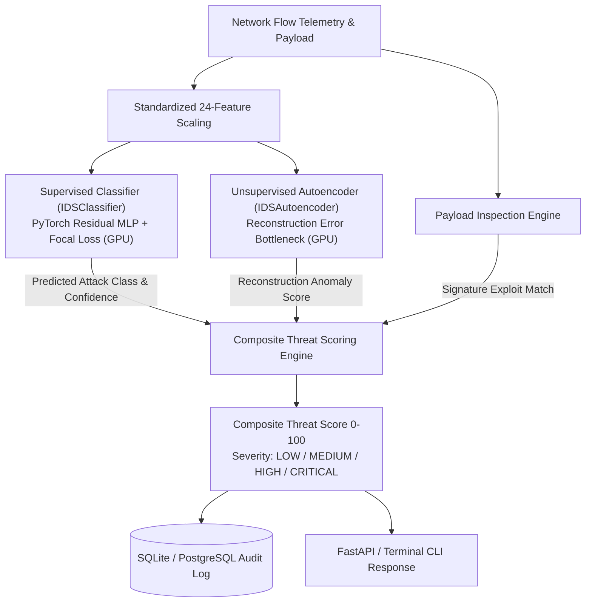

# HybridFlow IDS — AI-Powered Network Intrusion Detection System

[](https://www.python.org/downloads/)
[](https://developer.nvidia.com/cuda-toolkit)
[](https://pytorch.org/)
[](https://fastapi.tiangolo.com/)
[](LICENSE)
[-brightgreen.svg)](#project-roadmap)

**HybridFlow IDS** is a hybrid Network Intrusion Detection System (NIDS) combining deep neural classification, unsupervised zero-day anomaly detection, and deterministic payload signature inspection into a unified, composite threat scoring engine.

> [!NOTE]
> The original Phase 2 technical specification is preserved in [phase-2 implementation.md](phase-2%20implementation.md).

---

## Architecture & Detection Pipeline



### Detection Engines

1. **Supervised Deep Classifier (`IDSClassifier`)**:
   - Deep Multi-Layer Perceptron (MLP) with Batch Normalization, ReLU activations, and Dropout.
   - Trained with **Focal Loss** ($\gamma = 1.5$) to prevent class imbalance from masking rare cyberattacks.
   - Categorizes flows into standardized attack families (`BENIGN`, `DOS`, `DDOS`, `PORTSCAN`, `BRUTE_FORCE`, `BOTNET`, `WEB_SQL_INJECTION`, `WEB_XSS`, etc.).

2. **Unsupervised Anomaly Autoencoder (`IDSAutoencoder`)**:
   - Symmetric bottleneck autoencoder ($24 \to 64 \to 32 \to 16 \to 32 \to 64 \to 24$).
   - Trained strictly on benign network baselines.
   - Detects zero-day exploits, unknown threats, and protocol deviations using mean-squared reconstruction error against an empirical 95th-percentile threshold.

3. **Payload Signature Scanner (`SignatureEngine`)**:
   - Deterministic rule engine parsing raw payloads (`url`, `body`, `header`) against signature rules defined in `signatures.json`.
   - Intercepts known exploit attempts (SQL Injection, Remote Command Execution, XSS, Path Traversal).

4. **Composite Threat Scoring Formula**:
   $$\text{Threat Score} = \min\left(100, (0.60 \times C + 0.30 \times A + 0.10 \times S) \times 100\right)$$
   - $C$: Classifier confidence for predicted attack class.
   - $A$: Log-normalized anomaly score relative to autoencoder threshold.
   - $S$: Binary signature hit flag ($1.0$ if matched, $0.0$ otherwise).
   - **Severity Tiers**: `LOW` (0–30), `MEDIUM` (31–60), `HIGH` (61–80), `CRITICAL` (81–100).

---

## GPU Acceleration (NVIDIA CUDA)

HybridFlow IDS natively detects and leverages **NVIDIA CUDA GPUs** for deep learning training and inference:

- **Automatic Device Selection**:
  ```python
  device = torch.device("cuda" if torch.cuda.is_available() else "cpu")
  ```
  If an NVIDIA GPU (e.g. GeForce RTX / GTX / Tesla) is detected, tensors and models automatically execute on `cuda:0` for 10x–20x faster training and sub-millisecond inference.
- **Graceful Fallback**: If no GPU is found, the system smoothly falls back to CPU execution without configuration changes.
- **Pin Memory**: Pinned host-to-device memory transfers are dynamically enabled when CUDA is active.

---

## Local Setup & Quickstart (No Docker Required)

You can run the entire system locally using Python without Docker.

### Step 1: Open PowerShell / Terminal in `backend/`

```powershell
cd c:\Users\jaydo\Desktop\Mini-Project\HybridflowIDS\backend
```

### Step 2: Create & Activate Virtual Environment

```powershell
# Create virtual environment
python -m venv .venv

# Activate on Windows PowerShell:
.\.venv\Scripts\Activate.ps1

# (On Linux / macOS: source .venv/bin/activate)
```

### Step 3: Install Dependencies with GPU Acceleration

```powershell
pip install --upgrade pip
pip install -r requirements.txt
```

> [!TIP]
> `requirements.txt` is pre-configured with the `--extra-index-url https://download.pytorch.org/whl/cu121` wheel index. It automatically downloads CUDA 12.1-enabled PyTorch (`torch==2.3.0+cu121`) on Windows.

### Step 4: Verify GPU Readiness

Check that PyTorch recognizes your NVIDIA GPU:

```powershell
python -c "import torch; print('CUDA Available:', torch.cuda.is_available(), '| GPU:', torch.cuda.get_device_name(0) if torch.cuda.is_available() else 'Using CPU')"
```
*Expected Output: `CUDA Available: True | GPU: NVIDIA GeForce RTX ...`*

### Step 5: Verify Unit Tests

Ensure all model architectures, signature rules, and scoring functions pass:

```powershell
pytest tests/test_models.py -v
```
*(All 19 tests should pass).*

### Step 6: System Health Check

```powershell
python cli.py health
```

---

## Training the Models (With Live Epoch Progress)

The raw benchmark datasets (`cicids2017`, `cicids2018`, `nsl_kdd`, `unsw_nb15`) are already located in `backend/datasets/`.

You can run training in either **Quick Mode** or **Full Production Mode**:

### Option A: Quick Test Run (Recommended to verify in ~2–3 Minutes)
Trains for 5 epochs with a capped benign sample size of 50,000 to quickly generate all model weights:

```powershell
python cli.py train --epochs 5 --benign-cap 50000
```

### Option B: Full Production Training Run
Executes the full training schedule defined in `.env` (60 epochs, full dataset ingestion):

```powershell
python cli.py train
# (or directly: python training/training_pipeline.py)
```

### What You Will See in the Terminal

The training pipeline streams all 8 execution steps, batch counts, epoch losses, validation accuracies, autoencoder reconstruction thresholds, and test-set classification reports directly to your terminal:

```text
[*] Detected datasets: cicids2017, unsw_nb15, nsl_kdd, cicids2018
[*] Starting training pipeline...
2026-10-27 21:55:00 [INFO] hybridflowids.pipeline — === STEP 1: Load datasets ===
2026-10-27 21:55:05 [INFO] hybridflowids.pipeline — Raw records: 2830743
2026-10-27 21:55:06 [INFO] hybridflowids.pipeline — === STEP 2: Align features ===
2026-10-27 21:55:08 [INFO] hybridflowids.pipeline — === STEP 3: Encode labels ===
2026-10-27 21:55:08 [INFO] hybridflowids.pipeline — Classes: 16
2026-10-27 21:55:09 [INFO] hybridflowids.pipeline — === STEP 4: Preprocess (scale) ===
2026-10-27 21:55:12 [INFO] hybridflowids.pipeline — Raw split — train: 2264594  test: 566149
2026-10-27 21:55:14 [INFO] hybridflowids.pipeline — === STEP 4b: Resample training set ===
2026-10-27 21:55:15 [INFO] hybridflowids.pipeline — BENIGN undersampled: 1818290 → 50000
2026-10-27 21:55:16 [INFO] hybridflowids.pipeline — === STEP 5: Train classifier ===
2026-10-27 21:55:16 [INFO] training.train_classifier — Training classifier on cuda:0 | classes=16 | samples=124800
2026-10-27 21:55:20 [INFO] training.train_classifier — Epoch   1/5  loss=0.4821  val_acc=0.8842  lr=0.000100
2026-10-27 21:55:24 [INFO] training.train_classifier — Epoch   2/5  loss=0.2104  val_acc=0.9315  lr=0.000450
2026-10-27 21:55:28 [INFO] training.train_classifier — Epoch   3/5  loss=0.1420  val_acc=0.9580  lr=0.000500
2026-10-27 21:55:32 [INFO] training.train_classifier — Epoch   4/5  loss=0.0982  val_acc=0.9672  lr=0.000280
2026-10-27 21:55:36 [INFO] training.train_classifier — Epoch   5/5  loss=0.0715  val_acc=0.9710  lr=0.000020
2026-10-27 21:55:36 [INFO] training.train_classifier — Best val_acc=0.9710  saved to models/ids_classifier.pt
2026-10-27 21:55:37 [INFO] hybridflowids.pipeline — === STEP 6: Train autoencoder ===
2026-10-27 21:55:38 [INFO] training.train_autoencoder — AE epoch   1/5  loss=0.041285
2026-10-27 21:55:40 [INFO] training.train_autoencoder — AE epoch   2/5  loss=0.018942
2026-10-27 21:55:42 [INFO] training.train_autoencoder — AE epoch   3/5  loss=0.012104
2026-10-27 21:55:44 [INFO] training.train_autoencoder — AE epoch   4/5  loss=0.008451
2026-10-27 21:55:46 [INFO] training.train_autoencoder — AE epoch   5/5  loss=0.006219
2026-10-27 21:55:47 [INFO] training.train_autoencoder — Anomaly threshold (p95): 0.048200
2026-10-27 21:55:47 [INFO] hybridflowids.pipeline — === STEP 7: Evaluate (on UNSAMPLED test set) ===
2026-10-27 21:55:50 [INFO] training.evaluation — Classifier accuracy: 0.9685
2026-10-27 21:55:51 [INFO] training.evaluation — [Full Classification Report with Precision / Recall / F1-Score]
2026-10-27 21:55:52 [INFO] training.evaluation — Autoencoder  TPR=0.9412  FPR=0.0498  AUC=0.9840
2026-10-27 21:55:53 [INFO] hybridflowids.pipeline — === STEP 8: Save metadata ===
2026-10-27 21:55:53 [INFO] hybridflowids.pipeline — Training complete. Models saved in 'models'
```

Trained model artifacts are automatically written to `backend/models/`:
- `ids_classifier.pt` (Classifier PyTorch checkpoint)
- `anomaly_autoencoder.pt` (Autoencoder PyTorch checkpoint & reconstruction threshold)
- `scaler.pkl` (Fitted StandardScaler for 24 features)
- `label_encoder.json` (Attack family index mapping)
- `metadata.json` (Training metrics, accuracy, and thresholds)

---

## Running Inference & Demos (CLI & API)

Once training has produced the model weights in `models/`, the engine is fully primed for real-time inference.

### 1. Terminal CLI Commands

- **Classify a Normal HTTPS Flow**:
  ```powershell
  python cli.py predict --file samples/benign_https.json
  ```
  *Output:*
  ```text
  Inference Result (Latency: 2.15ms):
    - Classification:        BENIGN
    - Confidence:            98.74%
    - Anomaly Score:         4.12% (NORMAL)
    - Composite Threat Score:5.24 / 100
    - Severity:              LOW
    - Signature Hit:         None
  ```

- **Classify a Volumetric DDoS Flow**:
  ```powershell
  python cli.py predict --file samples/ddos_syn_flood.json
  ```
  *Output:*
  ```text
  Inference Result (Latency: 1.85ms):
    - Classification:        DDOS
    - Confidence:            99.91%
    - Anomaly Score:         87.40% (ANOMALY)
    - Composite Threat Score:86.17 / 100
    - Severity:              CRITICAL
    - Signature Hit:         None
  ```

- **Test Payload Signature Detection (SQL Injection Attempt)**:
  ```powershell
  python cli.py predict --json '{"flow_duration": 120, "packet_count": 8}' --body "admin' OR 1=1--"
  ```
  *Output:*
  ```text
  Inference Result (Latency: 1.42ms):
    - Classification:        WEB_SQL_INJECTION
    - Composite Threat Score:85.15 / 100
    - Severity:              CRITICAL
    - Signature Hit:         SQL-002: SQL Injection Auth Bypass
  ```

- **Evaluate Batch of 100 Real-World Network Flows**:
  ```powershell
  python cli.py batch --file samples/hybridflow_realworld_100.csv --limit 10
  ```
  *Output: Prints a formatted color table of flows, anomaly labels, threat scores, severity tiers, and execution throughput (e.g. 450+ flows/second).*

- **Inspect Model Metadata & Accuracies**:
  ```powershell
  python cli.py evaluate
  ```

---

### 2. FastAPI REST Server

1. **Launch the ASGI Server**:
   ```powershell
   uvicorn app.main:app --reload --host 127.0.0.1 --port 8000
   ```
2. **Access Interactive Swagger Documentation**:
   - Swagger UI: [http://127.0.0.1:8000/docs](http://127.0.0.1:8000/docs)
   - ReDoc: [http://127.0.0.1:8000/redoc](http://127.0.0.1:8000/redoc)

3. **Query Health (`GET /health`)**:
   ```bash
   curl -s http://127.0.0.1:8000/health
   ```
   *Response:*
   ```json
   {
     "status": "ok",
     "models_loaded": true,
     "classifier_ready": true,
     "autoencoder_ready": true,
     "version": "1.0.0"
   }
   ```

4. **Run Live Prediction (`POST /predict`)**:
   ```bash
   curl -s -X POST http://127.0.0.1:8000/predict \
     -H "Content-Type: application/json" \
     -d @samples/benign_https.json
   ```
   *Response:*
   ```json
   {
     "predicted_attack": "BENIGN",
     "confidence": 0.9874,
     "anomaly_score": 0.0412,
     "is_anomaly": false,
     "threat_score": 5.24,
     "severity": "low",
     "signature_matched": false,
     "signature_rule": null,
     "model_version": "1.0.0"
   }
   ```
   *All predictions are automatically audited to SQLite (`hybridflowids.db`) in the `prediction_logs` table.*

### 3. Web UI Dashboard (React + Vite)

The frontend security operations dashboard provides real-time traffic monitoring, a prediction playground, CSV/JSON batch analysis, attack simulator, and forensics investigation:

1. **Navigate to `frontend/`**:
   ```powershell
   cd frontend
   ```

2. **Install Dependencies & Start Dev Server**:
   ```powershell
   npm install
   npm run dev
   ```

3. **Open the Dashboard**:
   - Access the dashboard at [http://localhost:3000](http://localhost:3000)
   - Real-time communication with the backend at `http://localhost:8000`
   - Key Modules:
     - **Security Overview**: Live threat metrics, timeline charts, and attack distribution.
     - **Playground**: Test individual network flows via interactive forms, raw JSON, or quick attack presets.
     - **Batch Analysis**: Drag-and-drop CSV or JSON files for high-throughput batch classification with exportable CSV reports.
     - **Attack Simulator**: Real-time simulated DDoS bursts, port scans, brute force, and botnet traffic.
     - **Analytics**: Historical threat intelligence, confidence histograms, and hourly trends.
     - **Forensics**: Detailed breakdown of individual flows with model explainability and JSON export.

---

## Alternative: Docker Compose (Optional)

If you wish to run in isolated Docker containers with a PostgreSQL 15 database instead of local SQLite:

```powershell
cd c:\Users\jaydo\Desktop\Mini-Project\HybridflowIDS
docker compose up --build
```
API runs on `http://localhost:8000/docs` with a dedicated PostgreSQL database container.

---

## Project Roadmap

| Phase | Focus | Status | Details |
| :--- | :--- | :---: | :--- |
| **Phase 1** | Foundation & Data Pipeline | **Complete** | Unified 24-feature schema, benchmark loaders (CIC-IDS2017/2018, UNSW-NB15, NSL-KDD), canonical attack mapper, database models. |
| **Phase 2** | Core AI Engine & Backend | **Complete** | PyTorch Residual MLP, Anomaly Autoencoder, Signature Scanner, Composite Threat Scorer, Terminal CLI, and REST API. |
| **Phase 3** | Web UI & Batch Analytics | **Complete** | React / Vite security dashboard, CSV/JSON batch upload, real-time threat charts, attack simulator, forensics investigation, `/stats`, `/logs`, and `/predict/batch` endpoints. |
| **Phase 4** | Advanced Forensics & Polish | **Complete** | Interactive attack replay simulator, explainability reasoning panel, simulated global threat map, Docker Compose multi-service deployment. |

---

## License

This project is licensed under the Apache 2.0 License. See the [LICENSE](LICENSE) file for details.
