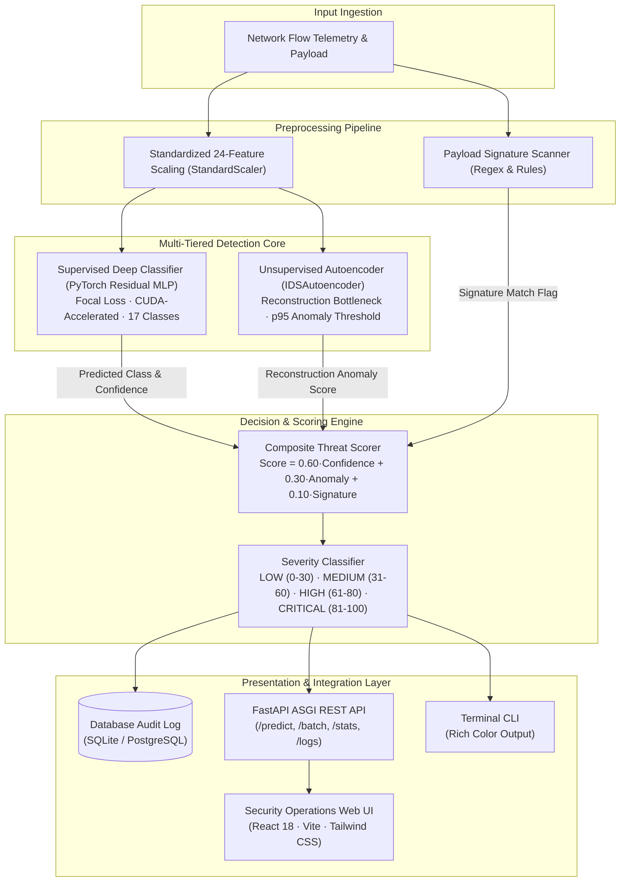

# HybridFlow IDS — AI-Powered Network Intrusion Detection System

[](https://www.python.org/downloads/)
[](https://developer.nvidia.com/cuda-toolkit)
[](https://pytorch.org/)
[](https://fastapi.tiangolo.com/)
[](https://react.dev/)
[](https://vitejs.dev/)
[]()
[](LICENSE)

**HybridFlow IDS** is an end-to-end, enterprise-grade Network Intrusion Detection System (NIDS) combining deep neural multi-class attack classification, unsupervised zero-day anomaly detection, and deterministic payload signature inspection into a unified, composite threat scoring engine. 

The platform pairs a high-throughput **PyTorch + CUDA backend** and **FastAPI REST engine** with a real-time **React + Vite Security Operations Dashboard**.

---

## Key Highlights

- **Multi-Tiered Hybrid Detection Pipeline**:
  - **Supervised Classifier**: Deep Residual MLP with Batch Normalization and Focal Loss ($\gamma = 1.5$) categorizing flows into 17 canonical attack families with **96.7% benchmark accuracy**.
  - **Unsupervised Anomaly Autoencoder**: Deep bottleneck reconstruction network trained strictly on benign traffic to flag zero-day exploits and abnormal protocol anomalies.
  - **Payload Signature Engine**: High-speed pattern matcher inspecting packet headers, URLs, and bodies for known exploits (SQL Injection, Remote Code Execution, XSS, Path Traversal).
  - **Composite Threat Scoring Engine**: Computes a continuous $0\text{--}100$ threat index and maps severity tiers (`LOW`, `MEDIUM`, `HIGH`, `CRITICAL`).
- **Real-Time Security Operations Dashboard**:
  - **Security Overview**: Live threat metrics, animated timeline charts, severity gauges, and attack distribution visualizers.
  - **Prediction Playground**: Interactive form sliders, raw JSON editors, and 1-click attack presets for immediate flow testing.
  - **Batch Analysis Engine**: Drag-and-drop CSV or JSON batches for bulk high-throughput evaluation with exportable audit reports.
  - **Attack Simulator**: Real-time traffic burst emulator for DDoS floods, port scans, brute force, and botnet traffic.
  - **Threat Analytics & Forensics**: Historical confidence distributions, telemetry breakdowns, model explainability, and database logs.
- **Hardware-Accelerated Performance**: Native NVIDIA CUDA detection with automatic tensor allocation on `cuda:0` and seamless CPU fallback.
- **Dual Audit Logging**: Full audit trail recorded automatically to an SQLite or PostgreSQL database with complete terminal and training logs persisted on disk.

---

## System Architecture



### Threat Scoring Formulation

$$\text{Threat Score} = \min\left(100, (0.60 \times C + 0.30 \times A + 0.10 \times S) \times 100\right)$$

- $C \in [0, 1]$: Classifier confidence for the predicted attack class.
- $A \in [0, 1]$: Log-normalized reconstruction anomaly score from the Autoencoder relative to the empirical 95th-percentile benign threshold.
- $S \in \{0, 1\}$: Deterministic payload signature match ($1.0$ if matched, $0.0$ otherwise).
- **Severity Classification**:
  - `LOW`: $0 \le \text{Score} \le 30$
  - `MEDIUM`: $31 \le \text{Score} \le 60$
  - `HIGH`: $61 \le \text{Score} \le 80$
  - `CRITICAL`: $81 \le \text{Score} \le 100$

---

## Standardized 24-Feature Schema

HybridFlow IDS normalizes raw network traffic from diverse captures and datasets into a unified 24-feature schema:

| Group | Features | Description |
| :--- | :--- | :--- |
| **Flow Timing** | `flow_duration`, `flow_iat_mean`, `flow_iat_std` | Flow lifespan and packet inter-arrival time statistics. |
| **Volume & Rates** | `packet_count`, `fwd_packets`, `bwd_packets`, `fwd_bwd_ratio`, `byte_count`, `fwd_bytes`, `bwd_bytes`, `flow_bytes_per_sec`, `flow_packets_per_sec` | Total transmission volumes, directional ratios, and byte/packet transfer rates. |
| **Packet Size** | `avg_packet_size`, `fwd_packet_size_mean`, `bwd_packet_size_mean` | Packet length averages across forward and backward directions. |
| **TCP Flags** | `syn_flag_count`, `ack_flag_count`, `rst_flag_count`, `fin_flag_count`, `psh_flag_count` | TCP control flags used to detect scans, half-open floods, and tear-downs. |
| **Payload Metrics** | `payload_length`, `payload_entropy`, `fwd_header_length`, `bwd_header_length` | Application payload size, Shannon entropy (encrypted vs. plain text), and header sizes. |

---

## Quickstart Guide

### Prerequisites

- **Python 3.11+**
- **Node.js 18+** & **npm**
- *(Optional)* NVIDIA GPU with CUDA 12.1+ driver for accelerated training/inference.

---

### Step 1: Start the Backend REST API

1. Open a PowerShell terminal and navigate to `backend/`:
   ```powershell
   cd backend
   ```

2. Create and activate a Python virtual environment:
   ```powershell
   # Windows PowerShell:
   python -m venv .venv
   .\.venv\Scripts\Activate.ps1

   # Linux / macOS:
   # python3 -m venv .venv && source .venv/bin/activate
   ```

3. Install backend dependencies (with GPU acceleration support):
   ```powershell
   pip install --upgrade pip
   pip install -r requirements.txt
   ```

4. Verify GPU availability:
   ```powershell
   python -c "import torch; print('CUDA Available:', torch.cuda.is_available(), '| Device:', torch.cuda.get_device_name(0) if torch.cuda.is_available() else 'Using CPU')"
   ```

5. Launch the FastAPI server:
   ```powershell
   uvicorn app.main:app --reload --host 127.0.0.1 --port 8000
   ```

- **Backend API**: [http://127.0.0.1:8000](http://127.0.0.1:8000)
- **Interactive Swagger Docs**: [http://127.0.0.1:8000/docs](http://127.0.0.1:8000/docs)
- **Health Check Endpoint**: [http://127.0.0.1:8000/health](http://127.0.0.1:8000/health)

---

### Step 2: Start the Web Dashboard

1. Open a second terminal and navigate to `frontend/`:
   ```powershell
   cd frontend
   ```

2. Install dependencies:
   ```powershell
   npm install
   ```

3. Start the Vite development server:
   ```powershell
   npm run dev
   ```

- **Dashboard UI**: [http://localhost:3000](http://localhost:3000)

---

## Web Security Operations Dashboard

The React + Vite dashboard connects directly to the FastAPI backend, offering six specialized modules:

1. **Security Overview**:
   - Live metrics summary: Active threat level, throughput flows/sec, anomaly detection rate, and signature alerts.
   - Dynamic timeline charts tracking threat score trends and rolling severities.
   - Attack family distribution donuts and system health gauges.
2. **Prediction Playground**:
   - Interactive sliders and input fields for all 24 flow metrics.
   - Raw JSON editing mode with preset templates (DDoS SYN Flood, Web SQL Injection, PortScan, Benign HTTPS).
   - Real-time scoring breakdown showing confidence scores, anomaly detection margins, and signature triggers.
3. **Batch Analysis**:
   - Drag-and-drop ingestion for multi-record CSV or JSON files.
   - Real-time progress bar and high-throughput evaluation (~450+ flows/second).
   - Filterable results table with one-click CSV export.
4. **Attack Simulator**:
   - Test detection defenses against simulated threat traffic: DDoS Volumetric Bursts, Slowloris HTTP Floods, SYN Port Scans, and SSH Brute Force.
   - Real-time event log with dynamic threat escalation.
5. **Analytics**:
   - Historical threat trends, confidence score histograms, and attack frequency analysis.
   - Severity distribution comparisons.
6. **Forensics**:
   - Deep-dive inspection of individual network flows with feature explainability breakdowns.
   - Direct access to historical audit logs stored in the database.

---

## Terminal CLI Usage

HybridFlow IDS provides a terminal CLI for headless servers, scripts, and automation pipelines:

```powershell
cd backend
.\.venv\Scripts\Activate.ps1
```

### 1. System Health & Readiness Check
```powershell
python cli.py health
```
Displays database connection status, loaded model versions, CUDA GPU detection, and signature rule counts in a formatted terminal table.

### 2. Predict a Single Flow (JSON Sample)
```powershell
# Evaluate a benign HTTPS session:
python cli.py predict --file samples/benign_https.json

# Evaluate a volumetric DDoS attack:
python cli.py predict --file samples/ddos_syn_flood.json
```

### 3. Evaluate Payload Signatures
```powershell
python cli.py predict --json '{"flow_duration": 120, "packet_count": 8}' --body "admin' OR 1=1--"
```
Intercepts SQL injection and web exploits via deterministic payload inspection.

### 4. High-Throughput Batch Processing
```powershell
python cli.py batch --file samples/hybridflow_realworld_100.csv --limit 20
```
Processes batches from CSV/JSON, outputting execution latency, throughput (flows/sec), and an audit summary table.

### 5. Inspect Model Performance & Architecture Metadata
```powershell
python cli.py evaluate
```
Prints trained class counts, classifier accuracy, autoencoder anomaly threshold, and hyperparameter configurations.

---

## Model Training Pipeline

The repository includes pre-processed benchmark loaders for **CIC-IDS2017**, **CIC-IDS2018**, **UNSW-NB15**, and **NSL-KDD** located in `backend/datasets/`.

### Run Training

To retrain the models with live epoch and batch progress streaming directly to the terminal:

```powershell
cd backend
.\.venv\Scripts\Activate.ps1

# Full training run (60 epochs, full dataset):
python cli.py train

# Fast training run (e.g., 10 epochs for quick validation):
python cli.py train --epochs 10 --benign-cap 100000
```

### Training Pipeline Stages

1. **Dataset Loading**: Ingests Parquet/CSV benchmark files with automated column mapping.
2. **Feature Alignment**: Normalizes variations into the canonical 24-feature schema.
3. **Label Encoding**: Resolves raw attack strings to standard canonical categories.
4. **Data Preprocessing**: Fits `StandardScaler` on continuous features and performs an 80/20 train/test split.
5. **Class Rebalancing**: Undersamples majority benign traffic to prevent class imbalance from masking stealthy attacks.
6. **Supervised Classifier Training**: Trains the PyTorch Residual MLP using **Focal Loss** ($\gamma = 1.5$) with cosine annealing learning rate schedules.
7. **Unsupervised Autoencoder Training**: Trains the bottleneck reconstruction network on benign traffic to establish the empirical 95th-percentile anomaly threshold.
8. **Test Set Evaluation & Artifact Persistence**: Computes multi-class precision, recall, F1, and AUC-ROC on the unsampled test set, saving updated artifacts to `backend/models/`:
   - `ids_classifier.pt`: PyTorch classifier weights.
   - `anomaly_autoencoder.pt`: PyTorch autoencoder checkpoint and p95 threshold.
   - `scaler.pkl`: Serialized `StandardScaler`.
   - `label_encoder.json`: Label-to-index mapping dictionary.
   - `metadata.json`: Model version, training parameters, and performance metrics.
   - `training.log`: Complete log of training epochs, batch loss values, and classification reports.

> [!TIP]
> **Windows 11 Users**: If you encounter `[WinError 4551] An Application Control policy has blocked this file` when loading PyTorch DLLs, ensure **Smart App Control** is set to **Off** in **Windows Security → App & browser control → Smart App Control settings**.

---

## Performance & Benchmark Metrics

Evaluated on an independent, unsampled benchmark test set of **2,281,657 records**:

| Metric | Score |
| :--- | :--- |
| **Overall Classifier Accuracy** | **96.68%** |
| **Weighted Average Precision** | **0.98** |
| **Weighted Average Recall** | **0.97** |
| **Weighted Average F1-Score** | **0.97** |
| **Autoencoder AUC-ROC** | **0.8784** |
| **Autoencoder False Positive Rate (FPR)** | **0.0495** |
| **Average Inference Latency** | **~1.5 – 2.5 ms / flow** (CUDA-accelerated) |
| **Batch Processing Throughput** | **450+ flows / second** |

### Supported Attack Classifications (17 Categories)

- `BENIGN` (Normal traffic)
- `DDOS` (Distributed Denial of Service)
- `DOS` (Denial of Service)
- `PORTSCAN` (Network reconnaissance, SYN / TCP sweeps)
- `BOTNET` (Command & Control communication)
- `BRUTE_FORCE` (SSH / FTP authentication attacks)
- `WEB_SQL_INJECTION` (SQL injection attempts)
- `WEB_XSS` (Cross-Site Scripting exploits)
- `WEB_BRUTE_FORCE` (HTTP credential stuffing)
- `EXPLOITS` (Software vulnerability exploits)
- `FUZZERS` (Protocol fuzzing attempts)
- `INFILTRATION` (Internal lateral movement)
- `BACKDOOR` (Persistent backdoor channels)
- `SHELLCODE` (Remote shellcode payloads)
- `WORM` (Self-propagating worms)
- `APACHE2` (Targeted HTTP server exploits)
- `GENERIC` (Generic malicious anomalies)

---

## REST API Reference

| Method | Endpoint | Description |
| :--- | :--- | :--- |
| `GET` | `/health` | Returns service health, model loading state, and engine readiness. |
| `POST` | `/predict` | Classifies a single flow from 24 telemetry features and optional payload. |
| `POST` | `/predict/batch` | Evaluates a batch array of flows; returns threat scores, anomaly flags, and latency. |
| `GET` | `/stats` | Returns real-time aggregate detection statistics, threat totals, and severity counts. |
| `DELETE`| `/stats/reset` | Resets running aggregate metrics counters. |
| `GET` | `/logs` | Queries historical prediction audit logs from the database (`limit` parameter supported). |
| `GET` | `/docs` | Interactive Swagger API explorer and schema documentation. |
| `GET` | `/redoc` | Alternative ReDoc API reference. |

---

## Alternative: Docker Deployment

To launch the full stack in isolated containers with a dedicated PostgreSQL database:

```powershell
docker compose up --build
```

- **Web Dashboard**: [http://localhost:3000](http://localhost:3000)
- **FastAPI Backend**: [http://localhost:8000/docs](http://localhost:8000/docs)
- **PostgreSQL Database**: Port `5432` (`hybridflowids` database)

---

## Project Structure

```text
HybridflowIDS/
├── backend/
│   ├── app/
│   │   ├── api/             # FastAPI route handlers and Pydantic schemas
│   │   ├── core/            # Database initialization and logging configuration
│   │   ├── ml/              # PyTorch models, preprocessor, scorer, model loader
│   │   ├── rules/           # Deterministic payload signature engine & rules
│   │   ├── config.py        # Centralized settings and environment variables
│   │   └── main.py          # FastAPI application entry point & CORS configuration
│   ├── datasets/            # CIC-IDS2017, CIC-IDS2018, UNSW-NB15, NSL-KDD
│   ├── models/              # Saved model weights, scaler, metadata, training logs
│   ├── samples/             # Sample JSON flows and CSV batch test files
│   ├── tests/               # PyTest unit test suite
│   ├── training/            # Training pipeline, feature alignment, label mapping
│   ├── cli.py               # Terminal CLI interface (predict, batch, train, health)
│   ├── requirements.txt     # Python dependencies with CUDA wheel index
│   └── .env                 # Hyperparameters and environment configuration
├── frontend/
│   ├── src/
│   │   ├── api/             # Axios API client and backend connection endpoints
│   │   ├── components/      # Threat gauges, timeline charts, layout, world map
│   │   ├── config/          # API URLs, color tokens, and feature schemas
│   │   ├── features/        # Dashboard, Playground, Batch Upload, Simulator, Forensics
│   │   ├── store/           # Zustand application state stores
│   │   └── styles/          # Design tokens and Tailwind CSS styles
│   ├── package.json         # React 18, Vite, Lucide, Recharts dependencies
│   ├── tailwind.config.ts   # Security dashboard dark theme color palette
│   └── vite.config.ts       # Vite configuration with proxy to backend
├── docker-compose.yml       # Multi-service container orchestration
└── README.md                # Project documentation
```

---

## License

This project is licensed under the Apache 2.0 License. See the [LICENSE](LICENSE) file for details.
